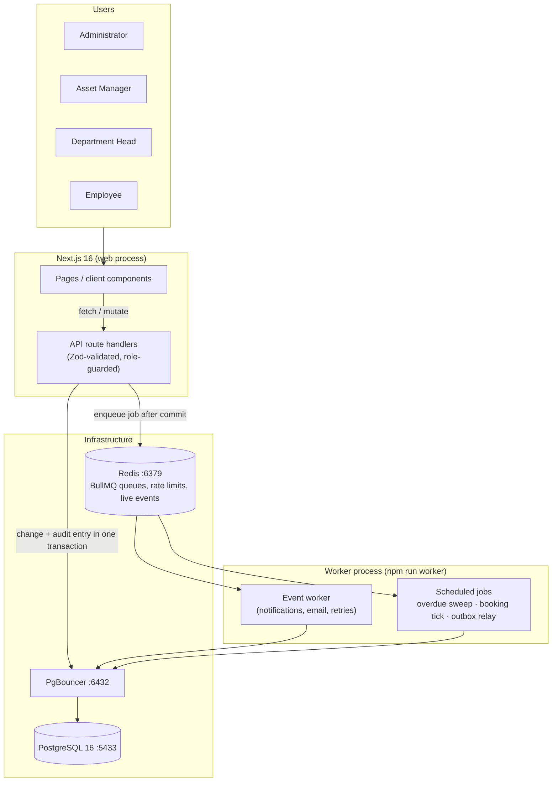
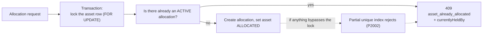
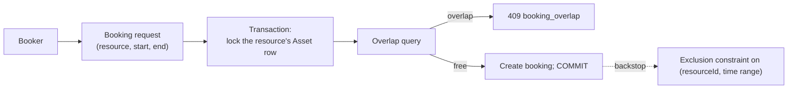
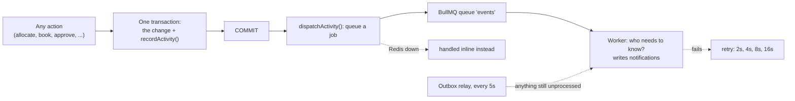
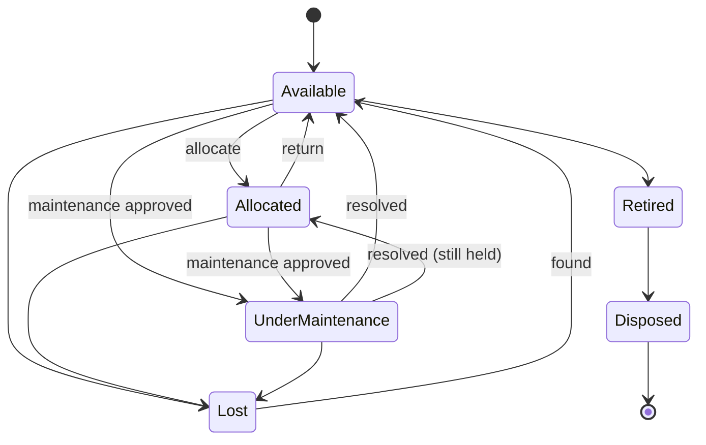

# AssetFlow

**Enterprise asset and resource management.** AssetFlow tracks, allocates, books and maintains physical assets (equipment, furniture, vehicles, rooms) across an organisation, with an audit trail for every change.

Built on Next.js 16, PostgreSQL and Redis. Conflicting operations (two people taking the same laptop, two bookings for the same room) are prevented by the database itself, not only by application code, and the test suite fires concurrent requests at a real database to prove it.

## Contents

1. [Features](#features)
2. [Architecture](#architecture)
3. [Tech stack](#tech-stack)
4. [Getting started](#getting-started)
5. [Configuration](#configuration)
6. [Running the app](#running-the-app)
7. [Concurrency guarantees](#concurrency-guarantees)
8. [Background jobs and event delivery](#background-jobs-and-event-delivery)
9. [Security](#security)
10. [Feature reference](#feature-reference)
11. [API reference](#api-reference)
12. [Data model](#data-model)
13. [Testing](#testing)
14. [Load testing](#load-testing)
15. [Deployment](#deployment)
16. [Operations](#operations)
17. [Troubleshooting](#troubleshooting)
18. [Known limitations](#known-limitations)
19. [Project structure](#project-structure)
20. [Contributing](#contributing)
21. [License](#license)

---

## Features

- **Asset registry:** tags, categories, owning department, serial numbers, condition, location, photos, QR labels and a scanner.
- **Allocation:** hand an asset to an employee or department; exactly one active allocation per asset, enforced by the database.
- **Transfers:** request and approval workflow; approvers and holders are notified.
- **Resource booking:** day grid for shared resources, overlap-free by constraint, with reschedule, cancel and a reminder before the start.
- **Maintenance:** a guarded state machine (pending, approved, in progress, resolved or rejected) with technician assignment.
- **Asset lifecycle:** edit, mark lost or found, retire, dispose; every transition is recorded in the asset's history.
- **Audit cycles:** scoped verification rounds with multiple auditors, a discrepancy report and an approve or reject step before close.
- **Reports:** utilisation, maintenance frequency, KPIs and a booking heatmap by weekday and hour.
- **Notifications:** pushed to the browser live over Server-Sent Events, produced by a background worker.
- **Accounts:** email verification, password reset, role-based access, session revocation and "sign out of all devices".
- **Audit trail:** every change writes an activity entry in the same transaction as the change itself.

## Architecture



- The **web process** serves pages and API routes. Every route validates input with Zod and re-checks the caller's role and account status in the database.
- The **worker process** turns events into notifications, sends email and runs the scheduled jobs. The web app keeps working while the worker is stopped; notifications wait and are delivered when it starts.
- **PostgreSQL** holds all state and the constraints that guarantee correctness. The running app and worker connect through **PgBouncer** (transaction pooling); migrations and tests connect directly.
- **Redis** carries the job queue, the rate-limit counters and the live-notification channel. If Redis is down the app degrades (inline delivery, in-memory limits) instead of failing.

## Tech stack

| Layer | Technology | Notes |
|---|---|---|
| Framework | Next.js 16 (App Router, Turbopack) | Pages and API route handlers in one app |
| Language | TypeScript | |
| UI | Tailwind CSS v4, shadcn/ui (Base UI primitives) | Sidebar, dropdown, dialog, table, sheet, tooltip |
| Tables | TanStack Table **v8** | Pinned to v8; v9 is a breaking API rewrite |
| Toasts | sonner | |
| State | Zustand | Client state beyond server data |
| Forms | React Hook Form + Zod resolver | Inline field-level errors |
| Charts | Recharts | Utilisation, maintenance frequency, heatmap |
| ORM | Prisma 6 | Schema and migrations; raw-SQL migrations for the partial index and exclusion constraint |
| Database | PostgreSQL 16 + PgBouncer | Migrations bypass the pooler via `DIRECT_URL` |
| Queue and jobs | Redis 7, BullMQ, ioredis | Separate worker process (`worker/`), run with `tsx` |
| Auth | NextAuth v5 (Credentials) + bcryptjs | JWT sessions |
| Email | nodemailer (SMTP) | Console output when SMTP is not configured |
| Validation | Zod | Shared schemas in `src/utils/schemas.ts` |
| Testing | Vitest, k6 | Real Postgres and Redis; k6 for load tests |

## Getting started

### Prerequisites

- Node.js 22 or newer (20 works)
- Docker Desktop (or any way to run PostgreSQL 16, PgBouncer and Redis 7)
- Optional: [k6](https://k6.io) for load tests

> **Windows tip:** keep the project outside OneDrive-synced folders. OneDrive scanning `node_modules` and `.next` can lock files and make `prisma generate` fail with `EPERM`.

### 1. Install

```powershell
git clone https://github.com/shrxprxyx/AssetFlow.git
cd assetflow
npm install
```

### 2. Start the infrastructure

```powershell
docker compose up -d
docker compose ps
```

| Service | Port | Used for |
|---|---|---|
| PostgreSQL | 5433 | migrations and tests (direct) |
| PgBouncer | 6432 | the running app and worker |
| Redis | 6379 | job queue, rate limits, live events |

### 3. Configure

```powershell
Copy-Item .env.example .env
npx auth secret    # paste the generated value into AUTH_SECRET
```

The variables are described under [Configuration](#configuration).

### 4. Migrate and seed (development only)

```powershell
npx prisma generate
npx prisma migrate dev
npx prisma db seed
```

Seeded accounts (password `password123`) exist for local development only. **Never run the seed against a production database.**

| Email | Role |
|---|---|
| `admin@assetflow.com` | Admin |
| `manager@assetflow.com` | Asset Manager |
| `head@assetflow.com` | Department Head |
| `priya.shah@assetflow.com` | Employee |

### 5. Run

```powershell
npm run dev        # terminal 1: the web app on http://localhost:3000
npm run worker     # terminal 2: the background worker
```

## Configuration

All settings are environment variables, read from `.env` locally. Never commit `.env`. The worker reads `.env` only when it starts, so restart it after changing a value.

| Variable | Required | Purpose |
|---|---|---|
| `DATABASE_URL` | yes | Runtime connection, through PgBouncer (`...:6432/...?schema=public&pgbouncer=true`) |
| `DIRECT_URL` | yes | Direct Postgres connection used by migrations (`...:5433/...`) |
| `REDIS_URL` | yes | Redis for queues, rate limits and live notifications |
| `AUTH_SECRET` | yes | Signs session tokens. Generate with `npx auth secret`; use a different value per environment |
| `APP_URL` | production | Public base address used in emailed links. Always taken from configuration, never from the request |
| `AUTH_URL` | production | Public address NextAuth trusts. On a real server set it to the public URL |
| `AUTH_TRUST_HOST` | local prod runs | Set to `true` for local production-mode runs such as load tests. Not needed in development |
| `UPLOAD_DIR` | no | Folder for uploaded photos (default `./uploads`, not in git) |
| `SMTP_HOST` | no | Enables real email. Without it, emails are printed to the console |
| `SMTP_PORT` | with SMTP | `587` (STARTTLS) or `465` (TLS) |
| `SMTP_USER`, `SMTP_PASS` | with SMTP | Credentials. Gmail needs an app password, not the account password |
| `MAIL_FROM` | with SMTP | Sender, for example `AssetFlow <no-reply@example.com>`. Required when `SMTP_HOST` is set |
| `RATE_LIMIT_DISABLED` | no | `true` switches rate limiting off. **Load tests only; never on a real server** |
| `RATE_LIMIT_STORE` | no | `memory` keeps rate-limit counters in process memory instead of Redis |
| `QUEUE_MODE` | no | `inline` handles events in the web process without Redis (used by tests) |

If SMTP is half-configured (host without sender) sending fails loudly instead of silently dropping mail. A server that refuses an email makes the queue retry it.

## Running the app

| Command | What it does |
|---|---|
| `npm run dev` | Web app in development mode |
| `npm run build` | Production build |
| `npm start` | Serve the production build |
| `npm run worker` | Background worker (jobs, notifications, email) |
| `npm test` | Run the whole test suite |
| `npm run test:watch` | Re-run affected tests on save |

Run `npm run worker` alongside the web app. Without it the app still works, but scheduled jobs (overdue sweep, booking reminders and status changes) do not run and notifications wait in the queue.

## Concurrency guarantees

Each guarantee is backed by a database constraint and covered by tests that send many simultaneous requests.

### One active allocation per asset



The row lock makes concurrent requests for one asset run one after another, so the check always sees committed state. The partial unique index is the actual guarantee: if anything ever slips past the application, the database rejects the second row and the API reports the same `409`.

```sql
CREATE UNIQUE INDEX "allocation_one_active_per_asset"
ON "Allocation" ("assetId")
WHERE "status" = 'ACTIVE';
```

Overdue allocations deliberately stay `ACTIVE`: that is the status the index protects, so an asset cannot be handed to someone else while it is still out.

### Overlap-free resource booking



The lock is taken on the resource's own row rather than on its existing bookings, so it also works for a resource's first booking. Adjacent slots (10:00 right after a 9:00-10:00 booking) are allowed; overlapping ones are rejected by the database even if two requests race.

```sql
ALTER TABLE "ResourceBooking" ADD CONSTRAINT "booking_no_overlap"
EXCLUDE USING gist ("resourceId" WITH =, tsrange("startTime", "endTime", '[)') WITH &&)
WHERE ("status" <> 'CANCELLED');
```

### Workflows that can be triggered twice

Maintenance approvals, transfer decisions, booking cancellations and asset status changes re-read the record under a lock (or use a guarded `UPDATE ... WHERE status = ...`), so a double click or two open tabs can never apply the same step twice.

## Background jobs and event delivery



- **The audit trail never depends on Redis.** It is written in the same database transaction as the change.
- **Deciding who to notify** is handed to the worker, so a request does not wait for it. Failed jobs are retried with exponential backoff and kept for inspection.
- **If Redis is unreachable** the web app creates the notifications itself and stops trying Redis for 10 seconds (a circuit breaker). Notifications are delayed at worst, never lost.
- **Scheduled jobs** are registered idempotently, so restarting the worker never duplicates them:
  - *Booking tick, every minute:* reminds the booker 15 minutes before a booking starts (once) and moves bookings `UPCOMING`, `ONGOING`, `COMPLETED`.
  - *Overdue sweep, every 5 minutes:* notifies the holder and the managers once per overdue allocation.
  - *Outbox relay, every 5 seconds:* delivers events that no job delivered (see below).

### Event delivery (outbox)

`ActivityLog` is the outbox. Every event is a row with `processedAt = NULL` until its notifications have been created.

1. **Write.** Code calls `recordActivity(tx, ...)` inside its own transaction, so the audit row commits together with the change it describes: both exist or neither does. This covers every mutation in the app, including password reset, "sign out everywhere", the overdue sweep and the booking reminders.
2. **Fast path.** After the commit, `dispatchActivity(id)` queues a job (or handles the event itself when Redis is down). It never throws.
3. **Safety net.** The worker's relay runs every 5 seconds and processes unprocessed events older than 5 seconds, oldest first (50 per run). It covers a crash after the commit, Redis being down, and a failed job.
4. **No duplicates.** `processActivityLog(id)` claims the row with `FOR UPDATE SKIP LOCKED`, so two workers never handle the same event at once, and notifications have a unique key (event, user, type), so handling an event twice notifies nobody twice.
5. **Poison events.** An event that keeps failing is retried up to 5 times (`processAttempts`) and then left alone. A database hiccup (database unreachable, pool busy) does not count against the 5 attempts; only errors from the event's own processing do. See [Operations](#operations) for how to find and retry stuck events.

Emails are not part of the outbox; they have their own queue with retries.

## Security

- **Authentication:** NextAuth credentials with bcrypt password hashes. Signup always creates an Employee; roles are assigned only by an Admin through the promote endpoint, which rejects `ADMIN` as a target.
- **Authorisation:** the session carries the role for the UI only. **Every API route re-reads the role and account status from the database**, so a demoted or deactivated user loses access immediately, not when their token expires.
- **Email verification:** a new account cannot sign in until its emailed link is opened. Links are single-use, expire after 24 hours, and only a hash of the token is stored. The password is checked before the "not verified" message appears, so it never reveals which addresses have accounts. Accounts that existed before this feature were marked verified by the migration.
- **Password reset:** links are single-use, expire after 30 minutes, and only a hash of the token is stored. Completing a reset also verifies the address.
- **Session revocation:** every session carries the account's `sessionVersion`; a session whose version is stale is rejected. The version changes on password reset, on deactivation or reactivation, and on "sign out of all devices". Sessions last 8 hours.
- **Account hygiene:** emails are stored trimmed and lowercase and compared ignoring case. Two simultaneous signups for one address cannot both succeed. Re-registering an unverified address resends the verification link without touching the pending account.
- **Rate limiting:** see the table below.
- **Uploads:** the file type is read from its first bytes, not from its name; files are stored under random UUIDs, served with `nosniff` and a sandboxing `Content-Security-Policy`, and only to signed-in users.
- **Input validation:** every route validates its input with Zod.
- **Links in email** always use `APP_URL` or `AUTH_URL` from configuration, never the request's host header.
- **Secrets** live only in environment variables. Rotate `AUTH_SECRET` and the SMTP password if they are ever exposed; rotating `AUTH_SECRET` signs everyone out.

### Rate limiting

Counters live in Redis (one fixed window per key), so the limits hold across every web instance. If Redis is down they fall back to per-process memory instead of rejecting requests. A blocked request gets `429` with a `Retry-After` header and `{ "error": "rate_limited", "retryAfterSec": n }`.

| What | Limit | Counted by |
|---|---|---|
| Sign-in | 10 attempts / 15 min | account email (cleared by a correct password) |
| Sign-in | 30 attempts / 15 min | caller address, across all accounts |
| Sign-up | 10 / hour | caller address |
| Forgot password | 10 / hour | caller address |
| Verify email | 20 / hour | caller address |
| Resend verification | 10 / hour | caller address (and one email a minute per account) |
| Reset password | 20 / hour | caller address |
| Any POST, PUT, PATCH, DELETE | 120 / minute | signed-in user |
| Photo upload | 30 / 10 min | signed-in user, on top of the write limit |

Reads are not limited. All numbers live in `src/services/rateLimit.ts` (`LIMITS`). The caller address comes from `X-Forwarded-For`, so run the app behind a proxy or load balancer that sets it.

## Feature reference

### Asset lifecycle



Allocated and Under Maintenance are managed by the allocation and maintenance workflows and cannot be set by hand; Lost, Found, Retired and Disposed are set through `POST /api/assets/:id/status`. Marking an allocated asset lost closes its allocation; losing or retiring a bookable asset cancels its upcoming bookings and notifies the bookers. A disposed asset is final. Every transition is written to `AssetHistory`.

### Audit cycles

1. **Create** (Admin): name, scope (all assets, a department, or a location), dates, and one or more auditors (Admin, Asset Manager or Department Head). Auditors are notified.
2. **Check** (assigned auditors only): mark each asset in scope Verified, Missing or Damaged. Assets outside the cycle's scope are refused. There is one finding per asset per cycle, enforced by a unique index; changing a verdict sends an earlier decision back to pending.
3. **Discrepancy report:** Missing and Damaged findings are collected automatically, with who flagged them.
4. **Decide** (Asset Manager or Admin): approve (confirm) or reject (dismiss) each flagged asset.
5. **Close** (Admin): refused while any flagged asset is undecided. Closing locks the cycle; approved Missing assets become Lost (their open allocation is closed and upcoming bookings cancelled); rejected ones are left alone.

### Live notifications

The bell opens one `EventSource` to `GET /api/notifications/stream`. Whenever notifications are saved, whether by a web request or by the worker, their user ids are published on a Redis channel; every web process forwards that to the matching open streams. The event carries no text: the bell reloads `GET /api/notifications`, so access rules stay in one place.

- Up to 5 open streams per user (a sixth gets `429`).
- A heartbeat every 25 seconds keeps idle connections alive through proxies. Behind nginx or similar, response buffering must be off (the stream sends `X-Accel-Buffering: no`).
- A stream ends after 30 minutes and the browser reconnects by itself, which re-checks the session.
- If Redis is down, only the process that created the notification pushes it; a 60-second refresh catches the rest.

### Photo uploads

Assets and maintenance requests can carry a photo. The form uploads the file to `POST /api/uploads` (multipart, field `file`), receives a path such as `/api/files/<random>.jpg`, and saves that path in `photoUrl`. `GET /api/files/<name>` serves it to signed-in users only.

- **Accepted:** JPEG, PNG and WebP up to 5 MB.
- **Names:** only names of the exact UUID shape are ever read from disk, so paths like `../..` never reach the file system.
- **`photoUrl` accepts** an uploaded path or a plain `http(s)` link. Other values, such as `javascript:`, are refused.
- **Storage is swappable.** Everything goes through the `FileStore` interface in `src/services/storage.ts` (`put`, `get`, `delete`); the default `LocalDiskStore` writes to `UPLOAD_DIR`. To use S3 or MinIO, add one class and change `getStore()`; saved paths, pages and forms stay the same.

### User roles

| Role | Capabilities |
|---|---|
| **Admin** | Departments, categories, audit cycles, employee and role management, everything an Asset Manager can do |
| **Asset Manager** | Register, edit and allocate assets, lost / found / retire / dispose, approve transfers and maintenance, cancel any booking, record audit findings |
| **Department Head** | View department assets, approve department transfer requests, allocate within their department, book shared resources |
| **Employee** | View own assets, book resources, raise maintenance requests, request transfers and returns |

### Screens

1. Login and signup (with email verification)
2. Dashboard (KPIs, overdue highlights, quick actions)
3. Organisation setup (departments, categories, employees), Admin only
4. Asset registration and directory (sortable table, edit and lifecycle actions)
5. Asset allocation and transfer (with approval inbox)
6. Resource booking (day grid, overlap validation, reschedule, cancel)
7. Maintenance management
8. Asset audit (cycles, discrepancy reports)
9. Reports and analytics (including the booking heatmap)
10. Activity log and notifications

## API reference

Base URL: `/api` (route handlers under `src/app/api/`). Sessions use NextAuth's JWT cookie.

```json
// Errors
{ "error": "machine_readable_code", "message": "Human readable", "field": "email" }

// Allocation conflict (409)
{ "error": "asset_already_allocated", "message": "...", "currentlyHeldBy": { "id": 7, "name": "..." } }
```

**Pagination.** List endpoints take `?page=` (default 1) and `?pageSize=` (default 25, capped at 100) and answer:

```json
{ "data": [], "total": 137, "page": 2, "pageSize": 25 }
```

`total` counts every row matching the filters and the caller's role, not just the current page. This applies to assets, allocations, employees, activity, transfers, maintenance requests, audit cycles and asset history. Departments, categories and bookable resources are small lists used as dropdowns and are returned whole; notifications return the latest 20; bookings are a per-day view.

| Method | Route | Who | Purpose |
|---|---|---|---|
| `POST` | `/api/auth/signup` | Public | Creates an Employee account only |
| `POST` | `/api/auth/verify-email` | Public | Confirms the address from the emailed link (single use, 24 h) |
| `POST` | `/api/auth/resend-verification` | Public | Sends a new link; answers the same whether or not the account exists; one email a minute per account |
| `POST` | `/api/auth/forgot-password` | Public | Emails a reset link; answers the same whether or not the account exists |
| `POST` | `/api/auth/reset-password` | Public | `{ token, password }`; the link works once and expires after 30 minutes |
| `POST` | `/api/account/sign-out-everywhere` | Signed in | Ends every session of the caller, this one included |
| `POST` | `/api/employees/:id/promote` | Admin | The only place a role is assigned |
| `POST` | `/api/employees/:id/department` | Admin | Move an employee to a department |
| `PATCH` | `/api/employees/:id/status` | Admin | Deactivate or reactivate an account (revokes its sessions) |
| `GET` | `/api/assets` | Signed in | Paginated; `?q=` searches tag, name, serial and location (case-insensitive), plus `categoryId`, `departmentId` and `status` filters |
| `POST` | `/api/assets` | Admin, Asset Manager | Register an asset (optional `departmentId`, must be an active department) |
| `GET` / `PATCH` | `/api/assets/:id` | Signed in / Admin, Asset Manager | Read / edit details (`departmentId` can be set, changed or cleared with `null`) |
| `POST` | `/api/assets/:id/status` | Admin, Asset Manager | Lost, found, retire, dispose |
| `GET` | `/api/assets/:id/history` | Signed in | Status history |
| `GET` | `/api/activity` | Signed in | Paginated audit log; `?category=ALERTS\|APPROVALS\|BOOKINGS` |
| `POST` | `/api/allocations` | Admin, Asset Manager, Dept Head | `409 asset_already_allocated` if held; department heads only within their department |
| `POST` | `/api/allocations/:id/return` | Holder / manager | Marks returned, records condition, asset back to `AVAILABLE` |
| `POST` | `/api/allocations/transfer` | Signed in | Request a transfer (managers' own requests are approved immediately) |
| `PATCH` | `/api/transfers/:id` | Approvers / requester | `{ "action": "approve" \| "reject" \| "cancel" }` |
| `GET` / `POST` | `/api/bookings` | Signed in | Day view / book (not in the past, max 12 h, `409 booking_overlap`) |
| `PATCH` | `/api/bookings/:id` | Booker, Admin, Asset Manager | Reschedule a booking that has not started; same overlap rules; re-arms the reminder |
| `DELETE` | `/api/bookings/:id` | Booker, Admin, Asset Manager | Cancel an upcoming or in-progress booking |
| `GET` / `POST` | `/api/maintenance-requests` | Signed in | List / raise |
| `PATCH` | `/api/maintenance-requests/:id` | Managers, assigned technician | Approve, reject, assign, start, resolve |
| `GET` / `POST` | `/api/audit-cycles` | Admin (create) | Cycles; create takes `auditorIds` and, for `LOCATION` scope, `scopeLocation` |
| `POST` / `DELETE` | `/api/audit-cycles/:id/auditors` | Admin | Add auditors / remove one (`?auditorId=`); one must remain |
| `PATCH` | `/api/audit-cycles/:id/findings` | Assigned auditors | Verified / Missing / Damaged; the asset must be in scope |
| `GET` | `/api/audit-cycles/:id/discrepancies` | Admin, Asset Manager, Dept Head | Flagged assets, who flagged them, decision status |
| `PATCH` | `/api/audit-cycles/:id/findings/:findingId/resolution` | Admin, Asset Manager | `{ decision: APPROVED \| REJECTED }` |
| `POST` | `/api/audit-cycles/:id/close` | Admin | Needs every flagged finding decided; approved Missing becomes Lost |
| `POST` | `/api/uploads` | Signed in | Upload a photo (multipart `file`, JPEG/PNG/WebP, max 5 MB); returns `{ url }` |
| `GET` | `/api/files/:name` | Signed in | Serve an uploaded photo |
| `GET` | `/api/notifications` | Signed in | Your notifications |
| `POST` | `/api/notifications` | Signed in | Mark your notifications read |
| `GET` | `/api/notifications/stream` | Signed in | Event stream: `notification` when you get new ones (max 5 open per user) |
| `GET` | `/api/reports`, `/api/dashboard` | Managers / signed in | Utilisation, maintenance frequency, KPIs |
| `GET` | `/api/reports/heatmap?days=7\|30\|90&tz=` | Managers | Booking utilisation by weekday and hour (cancelled bookings excluded) |

## Data model

| Entity | Key fields | Constraint / index |
|---|---|---|
| `User` | email, passwordHash, role, departmentId, status, emailVerifiedAt, sessionVersion | `email` unique (stored lowercase); roles writable only via the Admin-guarded promote endpoint |
| `EmailVerificationToken` | userId, tokenHash, expiresAt, usedAt | Only a hash is stored; single use |
| `Department` | name, parentDeptId, headId, status | Self-referencing FK; the API refuses parent loops |
| `AssetCategory` | name, customFields (JSON) | `name` unique |
| `Asset` | assetTag, categoryId, departmentId, serialNumber, condition, location, isBookable, status | `assetTag` and `serialNumber` unique; `departmentId` is the owning department (optional, stays put while the asset is lent out; the holder is the active `Allocation`); a department that owns assets cannot be deleted |
| `AssetHistory` | assetId, fromStatus, toStatus, actorId, reason | Immutable log of every status transition |
| `Allocation` | assetId, holderId, expectedReturnDate, status | **Partial unique index: one `ACTIVE` allocation per asset**; index on `(assetId, status)` |
| `TransferRequest` | assetId, fromHolderId, toHolderId, status | Pending, approved, rejected, cancelled |
| `ResourceBooking` | resourceId, bookerId, startTime, endTime, status, reminderSent | **Exclusion constraint: no overlapping non-cancelled bookings per resource** |
| `MaintenanceRequest` | assetId, requesterId, priority, status, technicianId | Pending, Approved, In Progress, Resolved / Rejected |
| `AuditCycle` | name, scopeType, scopeId, scopeLocation, startDate, endDate, status | Scope is `ALL`, a department, or a location text |
| `AuditAssignment` | cycleId, auditorId | One row per assigned auditor; only they can record findings |
| `AuditFinding` | cycleId, assetId, auditorId, status, resolutionStatus | One per asset per cycle (unique). `MISSING` / `DAMAGED` findings need an approve or reject decision |
| `Notification` | userId, type, message, relatedResourceType/Id, isRead | Unique on (event, user, type) so redelivery never duplicates |
| `ActivityLog` | actorId, action, resourceType, resourceId, changes (JSON), processedAt, processAttempts | Audit trail and outbox; written with `recordActivity()` inside the transaction of the change |

Full schema: `prisma/schema.prisma`.

## Testing

```powershell
# one-time: a separate database, because the tests wipe their tables
docker compose exec postgres psql -U assetflow -d postgres -c "CREATE DATABASE assetflow_test;"

npm test               # run everything
npm run test:watch     # re-run affected tests on save
```

The tests call the real route handlers and library code against a real Postgres (`assetflow_test`; they refuse to run against any database whose name does not end in `_test`). They cover:

- **Concurrency:** many simultaneous allocations, bookings, approvals, cancellations, status changes and sign-ups, asserting that exactly one succeeds and that the database constraints hold when the application checks are bypassed.
- **Permissions:** every role against the protected routes, deactivated users, stale session roles, revoked sessions.
- **Workflows:** maintenance, transfers, booking rules, asset lifecycle, returns, email verification, password reset.
- **Event delivery:** the outbox, relay and duplicate protection; the audit entry committing or rolling back with its change.
- **Background jobs:** the overdue sweep and booking tick, queue fallback logic, and (when Redis is running) the real worker, including an unreachable-Redis scenario.
- **Architecture:** `tests/layering.test.ts` fails the build if `src/utils` imports from `src/services`.

The worker tests use Redis database 15 and are skipped automatically if Redis is not running.

## Load testing

`load-test/` contains two k6 scripts and an integrity check:

- `race.js` fires 50 simultaneous requests at one asset or one room slot and expects exactly one winner.
- `mixed-load.js` runs 80 readers and 20 writers together and reports p95 latency per kind of request, the error rate, and whether the shared "hot" asset was ever allocated twice. Unexpected response statuses are printed once per user and endpoint.
- `integrity-check.sql` confirms after a run that the database holds no double allocation, overlapping booking or duplicate finding.
- `profile-summary.mjs` totals a Node CPU profile by area and function.

Setup steps are in `load-test/README.md`; recorded runs are in `load-test/RESULTS.md`.

100 users on one machine would hit the rate limits, so start the app for a load test with `RATE_LIMIT_DISABLED=true` and `AUTH_TRUST_HOST=true`, in the same terminal as the server, using the production build (`npm run build`, then `npm start`). Only the exact value `true` switches limits off, and a warning is printed. **Never set it on a real server.**

## Deployment

### Production checklist

- [ ] `npm run build` succeeds and the app runs with `npm start` (not `npm run dev`).
- [ ] `AUTH_SECRET` is a fresh random value, unique to this environment.
- [ ] `APP_URL` and `AUTH_URL` are set to the public address.
- [ ] `RATE_LIMIT_DISABLED` and `AUTH_TRUST_HOST` are **not** set (unless the proxy setup needs `AUTH_TRUST_HOST`).
- [ ] SMTP is configured (`SMTP_HOST`, `SMTP_PORT`, `SMTP_USER`, `SMTP_PASS`, `MAIL_FROM`).
- [ ] The worker (`npm run worker`) runs as its own supervised process and restarts on failure.
- [ ] Migrations are applied with `npx prisma migrate deploy` (never `migrate dev`), using `DIRECT_URL`.
- [ ] The seed is **not** run, and no default accounts exist.
- [ ] A reverse proxy or load balancer terminates TLS and sets `X-Forwarded-For`; response buffering is off for `/api/notifications/stream`.
- [ ] `UPLOAD_DIR` points to a persistent volume, or the file store has been swapped for object storage.
- [ ] Database and `UPLOAD_DIR` backups are scheduled and a restore has been tried.
- [ ] Redis and PostgreSQL are not exposed to the public network.

### Release steps

```powershell
npm ci
npx prisma migrate deploy
npm run build
# restart the web process (npm start) and the worker (npm run worker)
```

**Upgrading across the outbox migration.** The migration marks every existing event as processed so nobody is notified about history. Old web or worker processes still running after the migration keep notifying for the events they write, and the new relay would notify those a second time. Stop the old web app and worker before running `npx prisma migrate deploy`, then start the new ones. If you cannot stop them, once the new code is the only code running, run:

```sql
UPDATE "ActivityLog" SET "processedAt" = "timestamp"
WHERE "processedAt" IS NULL AND "timestamp" < '<time the new code went live>';
```

### Scaling

Web processes are stateless and can be run in several copies behind a load balancer: rate limits and live notifications go through Redis. Several workers are safe too; events are claimed with `FOR UPDATE SKIP LOCKED`. Local-disk uploads assume one server or a shared volume until the file store is swapped.

## Operations

**Stuck events.** An event that failed 5 times is left alone. List them:

```sql
SELECT id, action, "processAttempts", "timestamp" FROM "ActivityLog" WHERE "processedAt" IS NULL;
```

After fixing the cause, retry one with `UPDATE "ActivityLog" SET "processAttempts" = 0 WHERE id = <id>;`.

**Queue health.** Failed jobs are kept in the `events` queue for inspection. A growing set of unprocessed `ActivityLog` rows means the worker is stopped or failing; check its terminal output first.

**Email.** Without `SMTP_HOST`, emails are printed to the console of the process that sends them: the worker terminal when Redis is running, otherwise the web terminal. Failed sends are retried by the queue.

**Rate-limit log line.** `[rateLimit] Redis unavailable, counting in memory for 10s` appears once per start while the Redis connection is still opening, and again if Redis is lost. It is harmless: limits fall back to per-process counting.

**Removing a user.** There is no delete endpoint: an Admin deactivates the account (`PATCH /api/employees/:id/status`), which blocks sign-in and revokes its sessions while keeping the audit trail intact.

## Troubleshooting

| Symptom | Likely cause and fix |
|---|---|
| `prisma generate` fails with `EPERM` | The project is in a OneDrive-synced folder, or a dev server is holding the files. Move the project, stop running processes, retry |
| `/login` or `/api/auth/session` returns 404 | Wrong folder, or a stale `.next` cache. Stop the server, delete `.next`, start again from the project root |
| "Untrusted host" errors with `npm start` | Set `AUTH_URL` (real server) or `AUTH_TRUST_HOST=true` (local production run) |
| Verification or reset emails never arrive | Without `SMTP_HOST` they are printed in the worker (or web) terminal. After editing `.env`, restart the worker; it reads `.env` only at startup |
| Notifications stop appearing | The worker is not running, or Redis is down. Start `npm run worker` and check `REDIS_URL` |
| Overdue and reminder notifications never fire | They are scheduled jobs and run only while the worker is up |
| Load test shows many failures on writes | Rate limiting is on. Start the server with `RATE_LIMIT_DISABLED=true` |
| Tests refuse to start | The test database must exist and its name must end in `_test` (see [Testing](#testing)) |

## Known limitations

- A photo that is replaced or removed stays on disk, and photos uploaded but never saved are not cleaned up.
- Local-disk photo storage assumes one server or a shared volume.
- Emails are queued with retries but are not part of the outbox, so an email can be lost if the server dies between the change and the queueing.
- The caller address used for rate limiting comes from `X-Forwarded-For`; without a proxy that sets it, per-address limits are less meaningful.

## Project structure

Everything the app is made of lives under `src/`; the worker, database files, tests and tooling stay at the root. The worker imports from `src/services/`. One rule is enforced by a test: `src/utils` never imports from `src/services`.

```
assetflow/
├── src/
│   ├── app/
│   │   ├── (protected)/           # dashboard, assets, allocations, bookings, maintenance, audits, reports, activity, org-setup
│   │   ├── api/                   # route handlers: auth, account, assets, allocations, bookings, ...
│   │   ├── login/, signup/        # sign-in and registration
│   │   ├── verify-email/          # confirm an address from the emailed link
│   │   ├── forgot-password/       # ask for a reset link
│   │   ├── reset-password/        # choose a new password (from the emailed link)
│   │   └── page.tsx               # redirects to /login
│   ├── components/                # app-sidebar, topbar, notifications-bell, pager, search-select, QR label and scanner, ui/ (shadcn)
│   ├── services/                  # everything that talks to the database, Redis, mail, files or the network
│   │   ├── prisma.ts              # Prisma client singleton
│   │   ├── guards.ts              # requireAuth(): role, active status and session version read from the database
│   │   ├── allocations.ts         # allocate / return, row lock + unique-index backstop
│   │   ├── transfers.ts           # transfer request and approval workflow
│   │   ├── bookings.ts            # booking rules, row lock, cancel, reschedule
│   │   ├── maintenance.ts         # maintenance state machine
│   │   ├── assetLifecycle.ts      # edit + lost / found / retire / dispose
│   │   ├── audits.ts              # audit queries
│   │   ├── reports.ts             # report queries, booking heatmap data
│   │   ├── notifications.ts       # activity -> who should be notified
│   │   ├── outbox.ts              # recordActivity (in the transaction), dispatchActivity, relay
│   │   ├── queue.ts, realtime.ts, sse.ts  # BullMQ producer, live notifications
│   │   ├── mailer.ts              # sendMail() over SMTP (console when not configured) + queued delivery
│   │   ├── passwordReset.ts, emailVerification.ts, credentials.ts  # account emails and sign-in check
│   │   ├── rateLimit.ts, loginLimit.ts  # fixed-window limits, Redis with memory fallback
│   │   ├── storage.ts             # FileStore interface + local disk store
│   │   ├── sweeps.ts              # overdue sweep + booking tick (plain functions, testable)
│   │   └── assetTag.ts, userLookup.ts, api-client.ts
│   ├── utils/                     # pure helpers, no database or network
│   │   ├── schemas.ts             # Zod schemas
│   │   ├── http.ts, pagination.ts # request helpers, ?page / ?pageSize and the { data, total, page, pageSize } response
│   │   └── heatmap.ts, qr.ts, imageUpload.ts, auditScope.ts, utils.ts
│   ├── hooks/                     # use-mobile
│   ├── styles/                    # globals.css, design tokens
│   ├── types/next-auth.d.ts
│   ├── proxy.ts                   # runs before every request: redirects unauthenticated users to /login, 401s anonymous API calls
│   ├── auth.config.ts             # the part of the NextAuth setup that is safe to run in proxy.ts
│   └── auth.ts                    # NextAuth config (credentials, rate limit, email-verification check)
├── worker/
│   ├── runtime.ts                 # starts the event worker and schedules the jobs
│   └── index.ts                   # entry point: npm run worker
├── prisma/
│   ├── schema.prisma
│   ├── migrations/                # includes the partial unique index and exclusion constraint
│   └── seed.ts                    # development data only
├── tests/                         # Vitest suites and helpers
├── load-test/                     # k6 scripts, integrity check, profiling tool, recorded results
├── docker-compose.yml             # postgres, pgbouncer, redis
├── .env.example
└── README.md
```

## Contributing

1. Create a branch from `main`.
2. Start the infrastructure and the test database ([Getting started](#getting-started), [Testing](#testing)).
3. Make the change. Keep `src/utils` free of database and network imports; put anything that touches them in `src/services`.
4. A change that writes data must write its audit entry with `recordActivity(tx, ...)` inside the same transaction, and call `dispatchActivity(id)` after the commit.
5. Add or update tests, including a concurrency test for anything that could be triggered twice.
6. Run `npm test` and make sure it passes.
7. Open a pull request describing what changed and how you checked it.

Never commit `.env`, uploaded files, CPU profiles (`prof/`) or credentials.